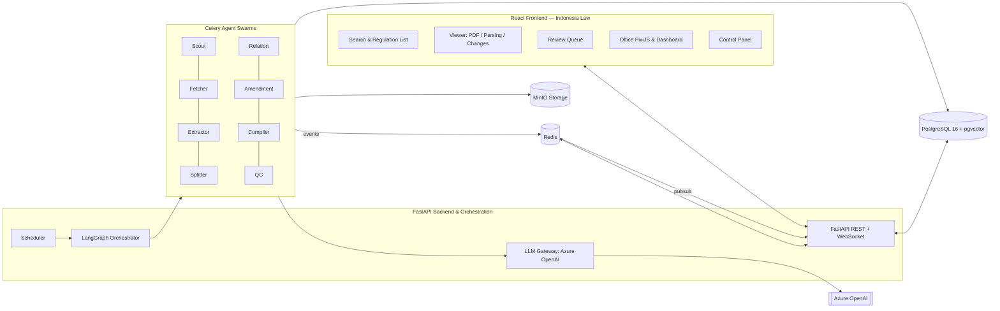

# Indonesia Law

> **Indonesia Law** is an intelligent multi-agent platform for collecting, extracting, structuring, linking relationships, tracking version amendments, searching, and reviewing laws and regulations of the Republic of Indonesia down to the granular level (**Pasal → Ayat → Huruf → Angka → Butir**), complete with provenance tracking for every text segment.

---

## 🏛️ Project Overview

The Indonesian legal system is highly complex, comprising tens of thousands of regulations that amend, revoke, or reference each other. **Indonesia Law** is designed to solve these challenges using an autonomous multi-agent pipeline:

* **Scout & Fetcher**: Identifies and downloads regulatory documents using polite scraping practices.
* **Extractor & Splitter**: Extracts text with line numbers and maps regulatory hierarchies down to the smallest granular item.
* **Verbatim Verifier**: Deterministically verifies that reconstructed texts are 100% identical to their original sources.
* **Relation & Amendment Analyzer**: Maps inter-regulation relationships (amends, revokes, references) and constructs consolidated version histories.
* **Layered QC & Review Queue**: Multi-tiered quality control prior to publication status, backed by a human-in-the-loop review interface.

---

## 🏗️ System Architecture



---

## 🚀 Getting Started (Quickstart)

### 1. Prerequisites
* **Docker & Docker Compose** (v2+)
* **Python 3.12+** and package manager [`uv`](https://docs.astral.sh/uv/)
* **Node.js 20+** and package manager `pnpm`

### 2. Copy and Configure Environment Variables (.env)
```bash
cp .env.example .env
```
Open `.env` and fill in the required configurations:
* `AZURE_OPENAI_API_KEY` and `AZURE_OPENAI_ENDPOINT`
* PostgreSQL and MinIO passwords
* `APP_STATIC_TOKEN` (can be generated with `openssl rand -hex 32`)

### 3. Start Supporting Services (Docker Compose)
Start PostgreSQL, Redis, and MinIO databases:
```bash
docker compose up -d postgres redis minio
```

Access the MinIO Console in your browser: `http://localhost:9001` (sign in using `MINIO_ROOT_USER` & `MINIO_ROOT_PASSWORD`).

### 4. Backend Setup
```bash
cd backend
uv venv
source .venv/bin/activate
uv pip install -e ".[dev]"

# Run API development server
uvicorn app.main:app --reload --port 8000
```
API Documentation (Swagger UI) will be available at `http://localhost:8000/docs`.

### 5. Frontend Setup
```bash
cd frontend
pnpm install
pnpm dev
```
The web application will be available at `http://localhost:3000` (or the port specified by Vite).

---

## 📁 Repository Structure

```
indonesia-law/
├── .agents/                 # AI agent configurations, skills (apple-design), and security rules
├── .env.example             # Safe environment variable configuration template
├── .gitignore               # Ignored secrets, build artifacts, and cache files
├── .dockerignore            # Files excluded during Docker build process
├── .cursorignore            # Prevents AI/Cursor from reading sensitive credentials
├── .agentignore             # Prevents AI agents from reading sensitive credentials
├── AGENTS.md                # Base instructions and guidelines for AI coding agents
├── SECURITY.md              # Security reporting policy & key rotation procedures
├── README.md                # Main project documentation
├── docker-compose.yml       # Container service definitions (Postgres, Redis, MinIO, API, Workers)
├── backend/                 # FastAPI source code, LangGraph orchestrator, Celery workers
├── frontend/                # React + TypeScript + Vite + Tailwind web application
├── plans/                   # Comprehensive design documents (01 to 12, phases, appendix)
│   ├── 01-vision-and-principles.md
│   ├── 02-architecture.md
│   ├── 03-data-model.md
│   ├── 04-agents-and-pipeline.md
│   ├── 05-prompts-and-llm.md
│   ├── 06-api-and-realtime.md
│   ├── 07-web-apps.md
│   ├── 08-design-system.md
│   ├── 09-observability-and-operations.md
│   ├── 10-testing-and-quality.md
│   ├── 11-roadmap.md
│   ├── 12-risks-and-decisions.md
│   ├── appendix/            # SQL schemas, prompt templates, office specifications
│   └── phases/              # Phased execution plans (F0 to F7)
├── ops/                     # Prometheus & Grafana configurations, backup scripts
└── scripts/                 # Automation & security verification scripts (verify-secrets.sh)
```

---

## 📖 Documentation

Full implementation plans, architecture specifications, and data models are available in the [`plans/`](plans/README.md) directory.

---

## 📄 License

Copyright © 2026 Indonesia Law Team. All rights reserved.
