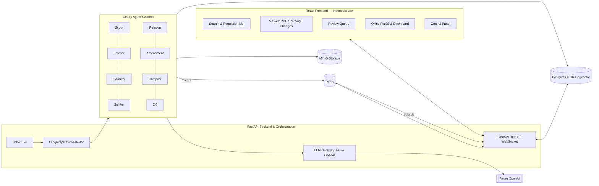

# Indonesia Law

> **Indonesia Law** adalah aplikasi multi-agent cerdas untuk mengumpulkan, mengekstrak, memecah struktur, menghubungkan relasi, melacak perubahan versi, mencari, dan meninjau peraturan perundang-undangan Republik Indonesia hingga tingkat terkecil (**Pasal → Ayat → Huruf → Angka → Butir**), lengkap dengan jejak asal-usul (*provenance*) untuk setiap potongan teks.

---

## 🏛️ Gambaran Umum Proyek

Sistem hukum Indonesia memiliki kompleksitas tinggi dengan puluhan ribu regulasi yang saling mengubah, mencabut, atau mengaitkan satu sama lain. **Indonesia Law** dirancang untuk memecahkan tantangan tersebut dengan arsitektur agen otonom (*agentic pipeline*):

* **Scout & Fetcher**: Mengidentifikasi dan mengunduh dokumen regulasi secara tertib (*polite scraping*).
* **Extractor & Splitter**: Mengekstrak teks dengan nomor baris dan memetakan hierarki regulasi hingga butir terkecil.
* **Verbatim Verifier**: Memverifikasi secara deterministik bahwa teks hasil rekonstruksi 100% identik dengan sumber aslinya.
* **Relation & Amendment Analyzer**: Memetakan hubungan antar-peraturan (mengubah, mencabut, mengaitkan) dan membangun riwayat versi konsolidasi.
* **Layered QC & Review Queue**: Pengawasan kualitas bertingkat sebelum status publikasi, didukung antarmuka peninjauan human-in-the-loop.

---

## 🏗️ Arsitektur Sistem



---

## 🔒 Keamanan & Praktik Vibe Coding

Proyek ini telah dikonfigurasi secara ketat untuk melindungi kredensial, API key, dan variabel lingkungan (*environment variables*) selama proses pengembangan (termasuk saat menggunakan coding assistant berbasis AI / *vibe coding* seperti Cursor, Windsurf, Copilot, atau Claude):

### 1. Perlindungan File `.env` & Secrets
* File `.env` dan segala variasinya (`.env.local`, `*.key`, `*.pem`, sertifikat, token) **diabaikan secara penuh oleh Git** melalui `.gitignore`.
* Gunakan [`.env.example`](.env.example) sebagai template konfigurasi dasar tanpa memasukkan kredensial asli.
* File [`.cursorignore`](.cursorignore) dan [`.agentignore`](.agentignore) memastikan AI assistant di lingkungan IDE tidak membaca isi file `.env` atau menyertakan token ke dalam context window model.

### 2. Aturan Keamanan Agen
* Agen dilarang keras mencetak, melakukan log, atau menulis kredensial/kunci API dalam bentuk plain text (lihat [`.agents/rules/security.md`](.agents/rules/security.md)).
* Sesuai kebijakan pertahanan prompt injection: seluruh konten dokumen regulasi yang diproses oleh LLM dianggap sebagai data murni, bukan instruksi eksekutabel.

### 3. Pengecekan Mandiri Sebelum Commit
Jalankan skrip verifikasi keamanan sebelum melakukan commit atau push:

```bash
bash scripts/verify-secrets.sh
```

Anda juga dapat memasang pre-commit hook otomatis:

```bash
pre-commit install
```

Kebijakan keamanan lengkap dan panduan rotasi kredensial dapat dibaca di [SECURITY.md](SECURITY.md).

---

## 🚀 Memulai Pengembangan (Quickstart)

### 1. Prasyarat
* **Docker & Docker Compose** (v2+)
* **Python 3.12+** dan package manager [`uv`](https://docs.astral.sh/uv/)
* **Node.js 20+** dan package manager `pnpm`

### 2. Salin dan Sesuaikan Lingkungan (.env)
```bash
cp .env.example .env
```
Buka file `.env` dan lengkapi konfigurasi yang diperlukan:
* `AZURE_OPENAI_API_KEY` dan `AZURE_OPENAI_ENDPOINT`
* Password PostgreSQL dan MinIO
* `APP_STATIC_TOKEN` (dapat dibuat dengan `openssl rand -hex 32`)

### 3. Jalankan Layanan Pendukung (Docker Compose)
Jalankan basis data PostgreSQL, Redis, dan MinIO:
```bash
docker compose up -d postgres redis minio
```

Akses konsol MinIO di browser: `http://localhost:9001` (login sesuai `MINIO_ROOT_USER` & `MINIO_ROOT_PASSWORD`).

### 4. Setup Backend
```bash
cd backend
uv venv
source .venv/bin/activate
uv pip install -e ".[dev]"

# Menjalankan server pengembangan API
uvicorn app.main:app --reload --port 8000
```
API Documentation (Swagger UI) akan tersedia di `http://localhost:8000/docs`.

### 5. Setup Frontend
```bash
cd frontend
pnpm install
pnpm dev
```
Aplikasi web akan tersedia di `http://localhost:3000` (atau port yang ditentukan Vite).

---

## 📁 Struktur Repositori

```
indonesia-law/
├── .agents/                 # Konfigurasi AI agent, skills (apple-design), dan security rules
├── .env.example             # Template konfigurasi variabel lingkungan aman
├── .gitignore               # Konfigurasi ignore file rahasia, build, dan cache
├── .dockerignore            # Konfigurasi ignore file rahasia saat proses Docker build
├── .cursorignore            # Pencegah pembacaan kredensial oleh AI/Cursor
├── .agentignore             # Pencegah pembacaan kredensial oleh AI agents
├── AGENTS.md                # Panduan instruksi dasar untuk AI coding agents
├── SECURITY.md              # Kebijakan pelaporan keamanan & rotasi kunci
├── README.md                # Dokumentasi utama proyek
├── docker-compose.yml       # Definisi layanan kontainer (Postgres, Redis, MinIO, API, Workers)
├── backend/                 # Source code FastAPI, LangGraph orchestrator, Celery workers
├── frontend/                # Aplikasi web React + TypeScript + Vite + Tailwind
├── plans/                   # Dokumen rancangan komprehensif (01 s/d 12, phases, appendix)
│   ├── 01-vision-and-principles.md
│   ├── 02-architecture.md
│   ├── 03-data-model.md
│   ├── 04-agents-and-pipeline.md
│   ├── 05-prompts-and-llm.md
│   ├── 06-api-and-realtime.md
│   ├── 07-web-apps.md
│   ├── 08-design-system.md
│   ├── 09-observability-and-operations.md
│   ├── 10-testing-and-quality.md
│   ├── 11-roadmap.md
│   ├── 12-risks-and-decisions.md
│   ├── appendix/            # Schema SQL, prompt templates, spek office
│   └── phases/              # Rencana eksekusi bertahap (F0 s/d F7)
├── ops/                     # Konfigurasi Prometheus, Grafana, dan skrip backup
└── scripts/                 # Utilitas otomasi & verifikasi keamanan (verify-secrets.sh)
```

---

## 📖 Dokumentasi Lengkap

Rencana implementasi, spesifikasi arsitektur, dan model data lengkap tersedia di direktori [`plans/`](plans/README.md).

---

## 📄 Lisensi

Hak Cipta © 2026 Indonesia Law Team. Seluruh hak cipta dilindungi undang-undang.

