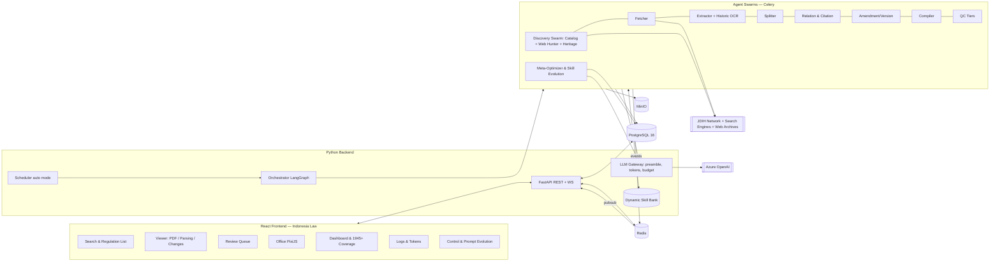

# 02 — System Architecture

## 1. Overview



## 2. Stack

| Layer | Choice |
|---|---|
| Frontend | React + TypeScript + Vite, React Router, TanStack Query, Zustand, Tailwind CSS (Apple token preset, see `08`), PixiJS, ECharts, pdf.js, TanStack Virtual, custom word diff |
| Fonts | `system-ui, -apple-system, BlinkMacSystemFont` → Inter (self-hosted, no CDN) |
| Backend API | Python 3.12, FastAPI, WebSocket |
| Agent orchestration | LangChain + LangGraph (one graph per pipeline, Postgres checkpoints) |
| LLM | Azure OpenAI via `langchain-openai` (`AzureChatOpenAI`); deployment name from env (initially "gpt 6 luna") |
| Workers | Celery + Redis; swarm = many instances per queue |
| Database | PostgreSQL 16 + `pg_trgm`, `btree_gist`, optional `pgvector` |
| Object storage | MinIO |
| Scraping | httpx; Playwright only for JS-heavy sites and Display QC |
| Observability | Own log tables + LangChain callback; optional Prometheus/Grafana/Langfuse (compose profile) |
| Deployment | Docker Compose |

All dependency versions are pinned exactly via lockfiles (`uv.lock`, `pnpm-lock.yaml`), chosen in Phase 0.

## 3. Monorepo Layout

```
indonesia-law/
├─ docker-compose.yml   .env.example   README.md
├─ docs/                       # copy of plans/ + runbook
├─ backend/
│  ├─ pyproject.toml   alembic/
│  └─ app/
│     ├─ main.py               # FastAPI
│     ├─ api/                  # runs, works, nodes, versions, relations, search, review, logs, metrics, control
│     ├─ core/                 # config, db, redis, events, ids, auth
│     ├─ llm/                  # gateway.py, callbacks.py, pricing.py, schemas/
│     ├─ prompts/              # preamble@v1.md + <id>@v<N>.md
│     ├─ evolution/            # optimizer.py, skill_bank.py, reflection.py, benchmark.py
│     ├─ agents/               # base.py, scout/ (catalog, search_hunter, heritage), fetcher/ extractor/ splitter/ relation/ amendment/ versioner/ compiler/ qc/ optimizer/
│     ├─ graphs/               # document_pipeline.py, discovery.py, recompile.py, evolution.py
│     ├─ scraping/             # ratelimit.py, robots.py, search_engine.py, adapters/<source>.py
│     ├─ verify/               # verbatim.py (deterministic)
│     ├─ workers/  scheduler/  tests/
├─ frontend/
│  └─ src/
│     ├─ app/                  # shell, router, providers
│     ├─ design/               # tokens, base components (Button, Badge, Tree, …)
│     ├─ features/             # search, viewer, review, office, dashboard, coverage1945, evolution, logs, control
│     └─ lib/                  # api, ws, store, i18n
└─ ops/                        # prometheus, grafana, backup scripts
```

## 4. Pipelines

**Document pipeline (LangGraph):** Discovered → Fetch → Extract (+ line numbers & historic spelling check) → Splitter (pointers) → Slice → Verbatim Verifier (fail → retry with feedback; fail N times → Review) → Node QC → Relation → Amendment Analyzer → Version Builder → Compiler → Version QC + Relation QC → Display QC → Chief QC → Published / returned to the responsible stage.

Document status: `discovered → fetched → extracted → split → verified → related → versioned → compiled → qc_passed → published` (+ `needs_review`, `failed`, `paused`). Every transition = event + checkpoint.

**Discovery Swarm pipeline:**
1. *Chronological Master Registry:* Seeds expected series (LNRI/BNRI, UU, Perppu, PP, Perpres, Penpres 1945–present).
2. *Open Web & Catalog Scouts:* Gathers regulatory listings and document URLs from across the open web (academic repositories, legal portals, digital libraries), prioritizing official `.go.id` adapters (BPK JDIH, JDIHN, Setneg/Setkab, Peraturan.go.id, MKRI/MARI).
3. *Web Search Hunters:* Uses search engine queries (e.g. via SearXNG / search APIs) to discover unindexed or missing historical PDFs across all web domains, with search result ranking biased toward `.go.id`.
4. *Heritage / Citation Scouts:* When relations cite an older instrument not yet in the DB (e.g. a 1950s emergency law cited in a 1970s law), a targeted open-web discovery task is queued.
5. *Deduplication & Canonical Rule:* Identifies works across manifestations (`jenis|nomor|tahun|instansi`), prioritizes official `.go.id` gazette scans, and schedules fetches.

**Prompt & Skill Evolution pipeline:**
Triggered continuously by human review decisions (`review_decision`), QC rejections, and novel document styles:
1. *Error & Feedback Mining:* Extracts input, failed output, correction/decision, and reason.
2. *Reflection & Root Cause Analysis:* Categorizes root cause (e.g. historical spelling, non-standard numbering, novel amending formula).
3. *Skill Bank Update:* Curates dynamic few-shot exemplars and tactical guidance into the vector-indexed `skill_bank`.
4. *Prompt Patch Generation:* Formulates candidate `@v(N+1)` prompts for the affected agent.
5. *Automated Golden-Set Regression Gate:* Runs candidate against the test suite (`eval:prompts`). If performance improves with zero regression on core invariants, flag as `candidate_approved` or auto-promote based on policy.

**Recompile pipeline:** when a new amending instrument is parsed, re-run Amendment → Version → Compile **only** for affected nodes.

## 5. Orchestration and Swarms

- The orchestrator decides *what* happens next per document; Celery workers execute *tasks*. Agents never call each other directly.
- Queues: `q.scout.catalog`, `q.scout.search`, `q.scout.heritage`, `q.fetch`, `q.fetch.js`, `q.extract`, `q.split`, `q.relation`, `q.version`, `q.compile`, `q.qc.node|relation|version|display|chief`, `q.evolution`.
- Limits: global tokens-per-minute bucket (Redis), per-domain concurrency, Azure quota (TPM/RPM) with 429 backoff.
- Priority: instrument hierarchy and dependencies (parents before amendments/implementing rules), manual > automatic.
- Idempotency: `task_key = sha256(work_id, stage, input_hash, prompt_version, model)`; a successful result is a cache hit on re-run.
- Heartbeat + lease; expired-lease tasks return to the queue. Circuit breaker per source/stage.

## 6. Polite Scraping

- Per-domain minimum interval 5–10 s + ±30% jitter, concurrency 1 per domain (configurable per adapter).
- Respect `robots.txt` and `Crawl-delay`; honest User-Agent with contact; crawl windows can be restricted (e.g., night hours WIB).
- Exponential backoff on 429/503; blocked → auto-pause the domain and flag it on the dashboard.
- Cache raw responses (ETag/If-Modified-Since); never re-download a file with an identical hash.
- Every request is logged in `http_request_log` (url, status, applied delay, duration) as compliance proof.

## 7. Docker Compose

Project `indonesia-law`, database `indonesia_law`.

| Service | Role | Notes |
|---|---|---|
| `postgres` | `pgvector/pgvector:pg16` | `pg_trgm`, `btree_gist` created by migration |
| `redis` | queues, pubsub, rate limiter | AOF on |
| `minio` | object storage | console never exposed publicly |
| `api`, `orchestrator`, `scheduler` | backend | |
| `worker-scout`, `worker-fetch` | concurrency 1 per domain | deliberately low (politeness); catalog, search & heritage queues |
| `worker-extract`, `worker-split`, `worker-relation`, `worker-version`, `worker-qc` | LLM swarms | `--scale` as needed |
| `worker-optimizer` | Skill & Prompt Evolution | processes reflection, candidate benchmarks, dynamic few-shot curation |
| `worker-browser` | Playwright: `q.fetch.js` + Display QC | **required from Phase 4** (optional profile in the original plan) |
| `frontend` | static build on Nginx | |
| `prometheus`, `grafana`, `langfuse`, `searxng` | `observability` & search helper profile | optional |

A full YAML example is in [Appendix D](appendix/D-docker-compose.md); apply the renames and the table above.

`.env.example`: `APP_NAME`, `AZURE_OPENAI_ENDPOINT`, `AZURE_OPENAI_API_KEY`, `AZURE_OPENAI_API_VERSION`, `AZURE_OPENAI_DEPLOYMENT`, `LLM_BUDGET_USD_PER_DAY`, `LLM_TPM_LIMIT`, `SCRAPE_MIN_DELAY_SEC=5`, `SCRAPE_JITTER_PCT=30`, `SCRAPE_PER_DOMAIN_CONCURRENCY=1`, `SCRAPER_CONTACT`, `POSTGRES_USER`, `POSTGRES_PASSWORD`, `MINIO_ROOT_USER`, `MINIO_ROOT_PASSWORD`, `APP_STATIC_TOKEN`.
