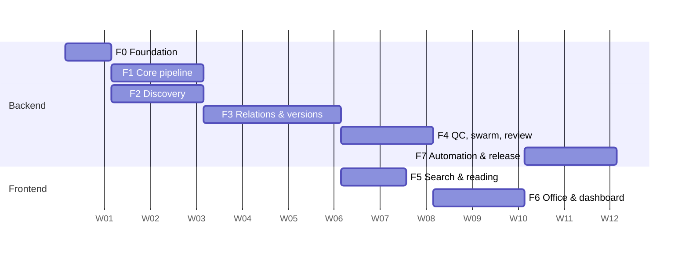

# 11 — Roadmap

Estimates assume 1–2 developers. The original six phases are kept and extended with a design-system foundation, a review queue and a dedicated search/reading phase, which the original plan referenced but never scheduled.

## 1. Phase Overview

| Phase | Name | Duration | Depends on | Detail |
|---|---|---|---|---|
| F0 | Foundation | 1 wk | — | [phases/F0-foundation.md](phases/F0-foundation.md) |
| F1 | Core single-document pipeline + basic viewer | 2 wk | F0 | [phases/F1-core-pipeline.md](phases/F1-core-pipeline.md) |
| F2 | Polite discovery, scraping, manual runs | 1–2 wk | F0 (parallel with late F1) | [phases/F2-discovery-and-scraping.md](phases/F2-discovery-and-scraping.md) |
| F3 | Relations, amendments, versioning, consolidation | 3 wk | F1, F2 | [phases/F3-relations-and-versioning.md](phases/F3-relations-and-versioning.md) |
| F4 | Layered QC, swarm scaling, review queue | 2 wk | F3 | [phases/F4-qc-swarm-review.md](phases/F4-qc-swarm-review.md) |
| F5 | Search and reading experience | 1.5 wk | F3 (parallel with F4) | [phases/F5-search-and-reading.md](phases/F5-search-and-reading.md) |
| F6 | Office visualization, dashboard, log explorer | 2 wk | F4 | [phases/F6-office-dashboard-logs.md](phases/F6-office-dashboard-logs.md) |
| F7 | Automation, scale, hardening, v1.0 | 2 wk | F4, F5, F6 | [phases/F7-automation-and-release.md](phases/F7-automation-and-release.md) |

Total: ~14–16 weeks sequential; ~12–13 weeks with two developers overlapping F2/F1 and F5/F4.

(Dates are placeholders; set the real start date at kickoff.)

## 2. Milestones

| Milestone | After | Demo |
|---|---|---|
| M1 "One document, verbatim" | F1 | Upload a PDF → tree in the viewer, 100% verbatim, tokens and cost logged |
| M2 "Corpus intake" | F2 | 1,000 metadata records crawled with provable delays |
| M3 "Time travel" | F3 | Pilot chain consolidated as of any date with per-provision diffs |
| M4 "Trustworthy at scale" | F4 | 10 workers, injected faults rejected, review queue resolving items |
| M5 "Readable" | F5 | Search → read → compare for the pilot corpus |
| M6 "Visible" | F6 | Live office, dashboard matching DB |
| v1.0 | F7 | Auto mode 72 h unattended, runbook, DoD met |

## 3. Definition of Done (v1.0)

- Pipeline runs end-to-end in manual **and** automatic mode.
- 100% of stored nodes pass the Verbatim Verifier; failures live only in the review queue.
- Smallest-provision versioning and consolidation as of a date for the pilot corpus, 5 chains verified by a human.
- Viewer (PDF ↔ parsing ↔ history), search, compare and review queue usable by keyboard; 0 serious/critical axe violations; one manual screen-reader pass done.
- UI follows `08-design-system.md` (light theme, review checklist passed).
- Real-time office, dashboard and complete token log; dashboard numbers match DB queries.
- `docker compose up` brings up everything; runbook and restore test documented.
- Measured cost per document and projected full-corpus cost presented and approved.
